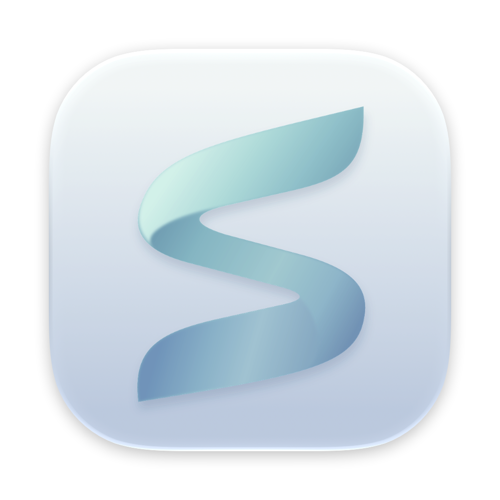

# SoftLive



**English** | [简体中文](README.zh-CN.md)

[](https://github.com/DigHuang/SoftLive/actions/workflows/ci.yml)
[](https://github.com/DigHuang/SoftLive/releases)


[](LICENSE)

A native macOS app that displays real-time synced lyrics for **Apple Music** and **NetEase Cloud Music** across the menu bar, a floating desktop overlay, a desktop widget, and a standalone kinetic Stage Mode window — paired with a lightweight menu bar system monitor for **CPU, memory, SoC temperature, and network throughput**.

- **Menu Bar Lyrics**: Displays the active lyric line in the menu bar with configurable max-width (`180 / 260 / 340 pt`) and automatic tail truncation; hides its status item when lyrics are turned off and the system monitor is active.
- **System Monitor**: Dedicated compact menu bar item (`52 × 22 pt` rate + bars or `20 × 22 pt` bars-only, with optional colored or monochrome template bars); click to expand a native **Liquid Glass** popover with 60-second sparklines, E/P-core and GPU load matrices, Top 10 processes (with two-step process termination), memory breakdown & swap, thermal sensors, system power (Watts), and fan RPM. Stops all sampling timers when disabled.
- **Desktop Floating Lyrics**: Always-on-top, non-activating, and click-through by default, with configurable font size (`22 / 26 / 30 pt`) and subline mode (translation-first, translation-only, or single-line); hold `⌘` and hover to reveal the glass backdrop, track title, `±0.5s` offset pills, and playback/lock/hide controls, with drag repositioning and double-click to skip tracks.
- **Desktop Widget**: Pinned above desktop icons and below normal application windows, with an artwork-tinted ambient aura. Collapses into a source selector card when idle, and expands with album artwork, track metadata, accent progress bar, and two-line karaoke lyrics during playback.
- **Stage Mode**: Standalone resizable window featuring **Luminous** and **Ink Trace** kinetic typography styles, artwork-driven aurora palette backgrounds, optional spark particles, a spinning vinyl interlude view, and double-click to skip tracks.
- **Desktop Configuration Center & Disk Cleaner**: Split-view window (`Player`, `Monitor`, and `Cleaner` tabs plus product overview) accessible by reopening SoftLive, pressing `⌘,` from the menu, or clicking the settings button in the monitor popover. Includes an allowlist-only, zero-permission **Cleaner** that scans rebuildable app caches, Xcode/Simulator caches, package manager caches, and stale build artifacts (`.build`, `node_modules`, `target`) on demand, skips running apps and symlinks, and moves selected items to the Trash.
- **Word-by-Word Sync**: Supports NetEase YRC word-by-word karaoke fill (falling back to line-by-line LRC), bilingual translation alignment, breathing interlude indicators, and manual `±0.5s` offset calibration per track.
- **100% Native**: Built with Swift 6.2, SwiftPM, AppKit, and SwiftUI with **zero third-party dependencies**. Requires **macOS 26+**.

## Build & Run

```bash
Scripts/build-app.sh --run
```

Builds `build/SoftLive.app` and restarts SoftLive. Omit `--run` to package without launching; to verify a Release build without replacing the running app bundle:

```bash
swift build -c release
```

Run the full test suite:

```bash
swift test
```

Apple Music requires granting **Automation → Music** permission on first launch; NetEase Cloud Music requires no system permissions.

> [!NOTE]
> macOS binds Automation permissions to the app's code signature. Because default ad-hoc signatures change on rebuild, you may be prompted again after rebuilding. Pass a stable signing identity to preserve permissions across builds:
> `SIGN_IDENTITY="Apple Development: …" Scripts/build-app.sh` (list available identities with `security find-identity -p codesigning`).

## Documentation

| Document | Description |
| --- | --- |
| [Changelog](CHANGELOG.md) ([中文](CHANGELOG.zh-CN.md)) | Version history, new features, performance improvements, and bug fixes |
| [AGENTS.md](AGENTS.md) | Developer entry point, directory structure, commands, and validation rules |
| [Requirements](docs/requirements.md) | Goals, acceptance criteria, non-goals, and pending verification items |
| [Subsystem Reference](docs/subsystems/README.md) | Architecture, data sources, runtime paths, and measured constraints |
| [Code Standards](docs/code-standards.md) | Coding and code-review standards |
| [Branding Assets](Resources/Branding/README.md) | Sync Frost icon sources and packaging commands |
| [Contributing](.github/CONTRIBUTING.md) ([中文](.github/CONTRIBUTING.zh-CN.md)) | Local development workflow, core boundaries, and PR guidelines |
| [Security Policy](.github/SECURITY.md) ([中文](.github/SECURITY.zh-CN.md)) | Permission model, privacy boundaries, and private vulnerability reporting |
| [LESSONS.md](LESSONS.md) | Engineering postmortems and rules derived from past bugs |

## Known Limitations

- **NetEase seek sync has a ~1–2s delay.** The NetEase client flushes whole-second progress records to disk roughly every 2 seconds; SoftLive converges immediately once the record lands. See [NetEase Source](docs/subsystems/netease.md).
- **Relies on NetEase private local storage formats.** Client updates may change cache naming or LevelDB encryption; fallback behavior is documented in [NetEase Source](docs/subsystems/netease.md).
- **macOS may hide menu bar items when crowded by the notch.** You can always access the main menu by right-clicking the unlocked desktop lyrics, desktop widget, or Stage Mode window, or by launching SoftLive again.
- **Word-by-word timing requires NetEase YRC data.** Not every track on NetEase has YRC timing, and LRCLIB provides line-synced LRC only.
- **Verification scope.** End-to-end Apple Music playback, on-screen Liquid Glass appearance, and Stage Mode live CPU benchmarks have documented verification boundaries in [Requirements](docs/requirements.md#待验证); dual-window desktop karaoke is measured at `0–0.8% CPU` in [UI & Rendering](docs/subsystems/ui.md#约束与失败行为).

## Acknowledgments

- **NetEase `lastPlaying` decoding**: [CloudLyrics-for-macOS](https://github.com/hellomyonly55/CloudLyrics-for-macOS).
- **Lyrics providers**: NetEase Cloud Music, [LRCLIB](https://lrclib.net).

## License

[MIT](LICENSE)
