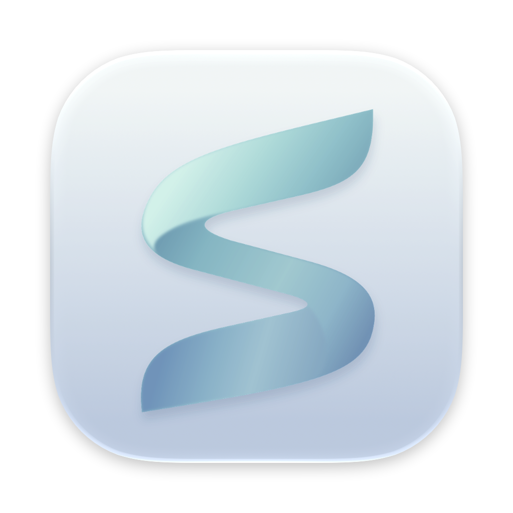

# SoftLive



[English](README.md) | **简体中文**

[](https://github.com/DigHuang/SoftLive/actions/workflows/ci.yml)
[](https://github.com/DigHuang/SoftLive/releases)


[](LICENSE)

在 macOS 的菜单栏、桌面悬浮窗、桌面组件和独立舞台窗口里，同步显示 **Apple Music / 网易云音乐** 正在播放的歌词，并在菜单栏监控 **CPU、内存、SoC 温度与上下行网速**。

- **状态栏歌词**：显示当前行，支持 `180 / 260 / 340 pt` 宽度上限与长句尾部截断。
- **系统监控**：独立紧凑状态栏项（支持 `52 × 22 pt` 网速+柱状图 / `20 × 22 pt` 仅柱状图，以及彩色或单色模板柱）；点击展开 Liquid Glass 详情面板，查看 CPU / RAM / 温度趋势、进程排行、功耗与风扇，支持确认后结束进程；关闭监控后停止采样。
- **桌面悬浮歌词**：置顶、不抢焦点，默认鼠标穿透，支持 `22 / 26 / 30 pt` 字号与副句显示模式（翻译优先 / 仅翻译 / 单行）；按住 `⌘` 移入唤醒控制栏（含曲目名与 `±0.5s` 偏移微调），支持拖动和双击切歌。
- **桌面组件**：位于桌面图标之上、App 窗口之下，采用封面流光与霜光玻璃材质。未播放时收起为播放器选择卡片，播放时展开封面、曲目、进度与歌词。
- **舞台模式**：独立可缩放窗口，提供「流光」与「描金」两种律动风格、封面取色背景、星火特效、黑胶间奏和双击切歌。默认关闭，从菜单或配置中心打开。
- **桌面配置中心与轻量空间清理**：左右分栏窗口（「播放器 / 监听 / 清理」三项导航与产品说明），可通过再次打开 SoftLive、右键菜单 `配置中心… (⌘,)` 或监控弹窗底栏唤起；内置零额外权限的纯白名单**空间清理**，按需扫描应用缓存、Xcode 缓存、包管理器缓存与闲置构建产物（`.build` / `node_modules` / `target`），自动跳过运行中应用与符号链接，确认后统一移入废纸篓。
- **歌词同步**：网易云 YRC 支持逐字高亮，无逐字数据时逐行显示；支持翻译、间奏指示和菜单内手动校正（每次 ±0.5 秒，换歌重置）。
- **原生实现**：Swift + AppKit + SwiftUI，零第三方依赖，需要 **macOS 26+ 与 Swift 6.2+ 工具链**。

## 构建与运行

```bash
Scripts/build-app.sh --run
```

构建 `build/SoftLive.app` 并重启 SoftLive。仅打包时省略 `--run`；仅检查 Release 编译、不替换 App 时运行：

```bash
swift build -c release
```

运行全部测试：

```bash
swift test
```

Apple Music 首次使用需允许「自动化 → Music」授权；网易云无需授权。

> [!NOTE]
> 自动化授权与代码签名绑定。默认 ad-hoc 签名在重新构建后可能变化，需要重新授权。可设置稳定签名身份打包：`SIGN_IDENTITY="Apple Development: …" Scripts/build-app.sh`；用 `security find-identity -p codesigning` 查看可用身份。

## 文档

| 文档 | 内容 |
| --- | --- |
| [更新日志](CHANGELOG.zh-CN.md) ([English](CHANGELOG.md)) | 版本演进、新增功能、性能优化与问题修复记录 |
| [AGENTS.md](AGENTS.md) | 开发入口、目录职责、命令与验证边界 |
| [需求](docs/requirements.md) | 目标、验收标准、明确不做的事与待验证项 |
| [子系统参考](docs/subsystems/README.md) | 各子系统的运行方式、约束与实测依据 |
| [代码规范](docs/code-standards.md) | 代码与审查标准 |
| [品牌资源](Resources/Branding/README.md) | Sync 霜光图标的源文件与打包方式 |
| [参与贡献](.github/CONTRIBUTING.zh-CN.md) ([English](.github/CONTRIBUTING.md)) | 本地开发、核心红线与提交 PR 规范 |
| [安全策略](.github/SECURITY.zh-CN.md) ([English](.github/SECURITY.md)) | 权限与隐私边界、安全漏洞私密报告方式 |
| [LESSONS.md](LESSONS.md) | 开发错误的证据与对应规则 |

## 已知限制

- **网易云拖动后的同步有延迟。** 本地进度记录只有整数秒，约每 2 秒写入一次；记录到达后再修正，详见 [网易云来源](docs/subsystems/netease.md)。
- **依赖网易云私有数据格式。** 客户端更新可能改变缓存格式；读取失败时的回退行为见同一页面。
- **菜单栏放不下时状态栏项可能被系统隐藏。** 可右键桌面歌词（未锁定时）、桌面组件或舞台窗口，或再次打开 SoftLive，访问主菜单。
- **逐字歌词只来自网易云 YRC。** 并非每首歌都有，LRCLIB 只提供逐行歌词。
- **验证有场景边界。** Apple Music 完整播放流程、实际玻璃效果和舞台性能的待验证情况见 [需求](docs/requirements.md#待验证)；桌面双窗口歌词的 CPU 实测见 [界面与渲染](docs/subsystems/ui.md#约束与失败行为)。

## 致谢

- **网易云 `lastPlaying` 读取方法**：[CloudLyrics-for-macOS](https://github.com/hellomyonly55/CloudLyrics-for-macOS)。
- **歌词来源**：网易云音乐、[LRCLIB](https://lrclib.net)。

## 许可证

[MIT](LICENSE)
